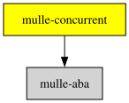

# mulle-concurrent

#### 📶 A lock- and wait-free hashtable, pointer array and pointer set, written in C

**mulle-concurrent** is a library for lock- and wait-free data structures.
Wait-freeness is a desirable property for "hotly" contested data structures
in multi-threaded environments.

> Many of the ideas are taken from [Preshing on Programming: A Resizable, Concurrent Map](http://preshing.com/20160222/a-resizable-concurrent-map/).
> The definition of concurrent and wait-free are from [concurrencyfreaks.blogspot.de](http://concurrencyfreaks.blogspot.de/2013/05/lock-free-and-wait-free-definition-and.html)

The mulle-concurrent-hashmap is the rock-solid foundation of this library.
The mulle-concurrent-pointerarray has been in use w/o problems for years, but recently got a bug fix.
The mulle-concurrent-hashtable is **EXPERMIMENTAL** but now in use.
The mulle-concurrent-pointerset is **EXPERIMENTAL** and currently unused.


| Release Version                                       | Release Notes  | AI Documentation
|-------------------------------------------------------|----------------|---------------
|      [](//github.com/mulle-concurrent/mulle-concurrent/actions) | [RELEASENOTES](RELEASENOTES.md) | [DeepWiki for mulle-concurrent](https://deepwiki.com/mulle-concurrent/mulle-concurrent)


## API

`WF` means wait-free; `WF*` means wait-free assuming wait-free allocation and
reclamation (the allocator is fail-fast, so pre-size if growth latency matters).

| Structure | Shape | Key | Duplicates | Deletion | Status |
|-----------|-------|-----|------------|----------|--------|
| [`mulle-concurrent-hashmap`](dox/API_HASHMAP.md) | hash → value | full-width, nonzero `intptr_t` | one value per key | single-threaded only (`_remove`, `_patch`) | stable |
| [`mulle-concurrent-hashtable`](dox/HASHTABLE.md) | hash → value | `intptr_t` with one reserved bit | one value per key | **concurrent `remove(hash,value)`, WF** | **EXPERIMENTAL** |
| [`mulle-concurrent-pointerarray`](dox/API_POINTERARRAY.md) | ordered pointers | `unsigned int` index | allowed | none | stable |
| [`mulle-concurrent-pointerset`](dox/API_POINTERSET.md) | set of pointers | the value itself | collapsed by the set | none (insert-only) | **EXPERIMENTAL** |

### Operations and progress

| Operation | hashmap | hashtable | pointerarray | pointerset |
|-----------|---------|-----------|--------------|------------|
| `init` / `done` | single-threaded | single-threaded | single-threaded | single-threaded |
| insert | `insert` **WF** | `insert` **WF** | `add` **WF** | `insert` **WF** |
| register | `register` **WF** | `register` **WF**, **lock-free** under same-key churn | — | `register` **WF** |
| lookup | `lookup` **WF** | `lookup` **WF** | `get` **WF** | `member` **WF** |
| delete | `_remove` / `_patch` single-threaded | `remove` **WF** | — | — |
| reset | — | — | — | single-threaded |
| count | weak snapshot | weak snapshot | `get_count` **WF** | weak snapshot |
| iterate | weak snapshot | weak snapshot | weak snapshot | weak snapshot |
| growth | **WF\*** | **WF\*** | **WF\*** | **WF\*** |

**WF** point operations are safe from any number of registered threads and never
wait for another thread (they may help complete a migration). **Weak snapshot**
operations are multi-threaded but may restart or observe a mixture of
generations; they are not wait-free. **Single-threaded** operations are undefined
behavior if another thread accesses the structure concurrently.

### Key and value scope

| Structure | Key scope | Value scope | Rejected / reserved |
|-----------|-----------|-------------|---------------------|
| hashmap | any nonzero `intptr_t`; full width, so a pointer can be used as the hash on LP64 | any `void *` except `NULL` and `INTPTR_MIN`; `INTPTR_MAX` is allowed | key `0`; value `NULL`, `INTPTR_MIN` |
| hashtable | mode-dependent: positive nonzero, or even nonzero; one hash bit is reserved | mode-dependent: even non-`NULL` (default), or positive `[1, INTPTR_MAX-1]`; one value bit and a TOMB value are reserved | key `0` and keys with the FROZEN bit; values with the SEALED bit, `NULL`, and the TOMB value |
| pointerarray | `unsigned int` index in `[0, count)` | any `void *` except `NULL` and `INTPTR_MIN`; duplicates allowed | `NULL`, `INTPTR_MIN` |
| pointerset | the pointer value itself (hashed internally) | any `void *` except `NULL`, `INTPTR_MIN` and `INTPTR_MAX`; duplicates collapse | `NULL`, `INTPTR_MIN`, `INTPTR_MAX` |

The hashtable's default mode is positive hashes and even values. Even-value mode
needs 2-byte alignment; use positive values for integers. The pointerset does not
use `INTPTR_MAX` internally, but keeps it reserved library-wide and rejects it as
user data.

For the hashmap progress argument, see
[Wait-free status of the hashmap point operations](dox/WAIT-FREE-LOCK-FREE.md).
For why the hashmap has no concurrent `remove` and the hashtable does, see
[Remove misery](dox/REMOVE-MISERY-HASHMAP.md) and [hashtable](dox/HASHTABLE.md).


## Documentation & Guides

* [API Summary](asset/dox/api/toc)
* [Coder Guide](asset/howto/coder/mulle-concurrent)

## Usage

mulle-concurrent data structures require
[mulle-aba](//github.com/mulle-concurrent/mulle-aba) for safe concurrent memory
reclamation. You must initialize mulle-aba once per process and **register every
thread** that accesses mulle-concurrent data structures.

``` c
#include <mulle-concurrent/mulle-concurrent.h>

int   main( int argc, char *argv[])
{
   struct mulle_concurrent_hashmap   map;

   mulle_aba_init( NULL);                          // once per process
   mulle_aba_register();                           // register main thread

   mulle_concurrent_hashmap_init( &map, 0, NULL);

   // ... use the hashmap ...

   mulle_concurrent_hashmap_done( &map);

   mulle_aba_unregister();                         // unregister main thread
   mulle_aba_done();                               // once per process
   return( 0);
}
```

### Multi-threaded setup

**Every participating thread** must call `mulle_aba_register` before accessing
any mulle-concurrent data structure and `mulle_aba_unregister` before exiting.
Forgetting to do so will crash.

With `mulle_thread` you can automate the unregister with a TSS destructor:

``` c
#include <mulle-concurrent/mulle-concurrent.h>

static mulle_thread_tss_t   aba_tss_key;


static void   aba_thread_destructor( void *value)
{
   mulle_aba_unregister();
}


// call once from main before spawning threads
static void   aba_setup_thread_cleanup( void)
{
   mulle_thread_tss_create( aba_thread_destructor, &aba_tss_key);
}


// call at the start of each thread function
static void   aba_register_thread( void)
{
   mulle_aba_register();
   mulle_thread_tss_set( aba_tss_key, (void *) 1);  // non-NULL triggers destructor
}
```

Then your thread function becomes:

``` c
static void   *my_worker( void *arg)
{
   struct mulle_concurrent_hashmap   *map = arg;

   aba_register_thread();

   // ... safely use map ...

   return( NULL);  // destructor calls mulle_aba_unregister automatically
}
```


## Checklist

* `init` and `done` operations must be done singlethreaded
* Every thread that touches a mulle-concurrent data structure must be registered with mulle-aba.
* Enumeration is only to be used singlethreaded and for debugging purposes
* `count`, `get_size`, `get_count` return informational values, they may have already changed


## Reserved pointer values

The containers store `void *` pointers and reserve a few values for internal
use. **Never store a value as payload in a container that reserves it.**

| Value                 | Constant                            | Meaning                           | Reserved by
|-----------------------|-------------------------------------|-----------------------------------|-------------------
| `0` (hash)            | `MULLE_CONCURRENT_NO_HASH`          | unclaimed slot / invalid hash     | hashmap, hashtable
| `NULL`                | `MULLE_CONCURRENT_NO_POINTER`       | "no value" sentinel / empty slot  | all structures
| `(void *) INTPTR_MIN` | `MULLE_CONCURRENT_INVALID_POINTER`  | hashmap REDIRECT freeze marker, hashtable TOMB (even values) | hashmap, pointerarray, pointerset, hashtable (even values)
| `(void *) INTPTR_MAX` | `MULLE_CONCURRENT_TOMBSTONE_POINTER`| hashtable TOMB (positive values)                              | hashtable (positive values)
| odd / top bit set     | —                                   | hashtable SEALED bit              | hashtable (even / positive values)

The values are defined in `src/mulle-concurrent-types.h`. They are
compile-time constants derived from the platform's `intptr_t`, so the
reserved set is fixed per architecture. Passing a reserved value to an
operation that rejects it returns `EINVAL`.

The **hashtable** restricts keys and values by its key and value modes.

## Memory allocation

All allocation is **fail-fast**: the mulle allocator contract is *success or
abort*. When the default allocator cannot satisfy an allocation it prints an
error and aborts the process. The API therefore only reports allocation
failure by aborting; do not write code that depends on recovering from it.

Use an arena allocator, to avoid serialization through malloc.


### You are here




## Add

**This project is a component of the [mulle-core](//github.com/mulle-core/mulle-core) library. As such you usually will *not* add or install it individually, unless you specifically do not want to link against `mulle-core`.**


### Add as a cmake subproject

mulle-concurrent is intended to be consumed as a cmake subproject with
[FetchContent](https://cmake.org/cmake/help/latest/module/FetchContent.html) —
no mulle tooling is required in the parent build:

``` cmake
include( FetchContent)

set( MULLE__CONCURRENT_TAG "master" CACHE STRING "branch or tag to fetch mulle-concurrent from")

FetchContent_Declare( MULLE__CONCURRENT
   GIT_REPOSITORY https://github.com/mulle-concurrent/mulle-concurrent.git
   GIT_TAG        "${MULLE__CONCURRENT_TAG}")
FetchContent_MakeAvailable( MULLE__CONCURRENT)

target_link_libraries( my_target PRIVATE mulle-concurrent)
```

``` c
#include <mulle-concurrent/mulle-concurrent.h>
```

The parent project must supply the mulle dependency graph — `mulle-aba` and its transitive targets (e.g. by also adding `mulle-core`) — so that the dependency resolves to CMake targets rather than system libraries.


### Add with mulle-sde (mulle ecosystem)

Use [mulle-sde](//github.com/mulle-sde) to add mulle-concurrent to your project:

``` sh
mulle-sde add github:mulle-concurrent/mulle-concurrent
```


### Embed with clib (sources only)

To only add the sources of mulle-concurrent with dependency sources use [clib](https://github.com/clibs/clib):

``` sh
clib install --out src/mulle-concurrent mulle-concurrent/mulle-concurrent
```

Add `-isystem src/mulle-concurrent` to your `CFLAGS` and compile all the sources that were downloaded with your project.

## Install

Use [mulle-sde](//github.com/mulle-sde) to build and install mulle-concurrent and all dependencies:

``` sh
mulle-sde install --prefix /usr/local \
   https://github.com/mulle-concurrent/mulle-concurrent/archive/latest.tar.gz
```

### Manual Installation

Install the requirements:

| Requirements                                 | Description
|----------------------------------------------|-----------------------
| [mulle-aba](https://github.com/mulle-concurrent/mulle-aba)             | 🚮 A lock-free, cross-platform solution to the ABA problem

Download the latest [tar](https://github.com/mulle-concurrent/mulle-concurrent/archive/refs/tags/latest.tar.gz) or [zip](https://github.com/mulle-concurrent/mulle-concurrent/archive/refs/tags/latest.zip) archive and unpack it.

Install **mulle-concurrent** into `/usr/local` with [cmake](https://cmake.org):

``` sh
PREFIX_DIR="/usr/local"
cmake -B build                               \
      -DMULLE_SDK_PATH="${PREFIX_DIR}"       \
      -DCMAKE_INSTALL_PREFIX="${PREFIX_DIR}" \
      -DCMAKE_PREFIX_PATH="${PREFIX_DIR}"    \
      -DCMAKE_BUILD_TYPE=Release &&
cmake --build build --config Release &&
cmake --install build --config Release
```


## Author

[Nat!](https://mulle-kybernetik.com/weblog) for Mulle kybernetiK  


